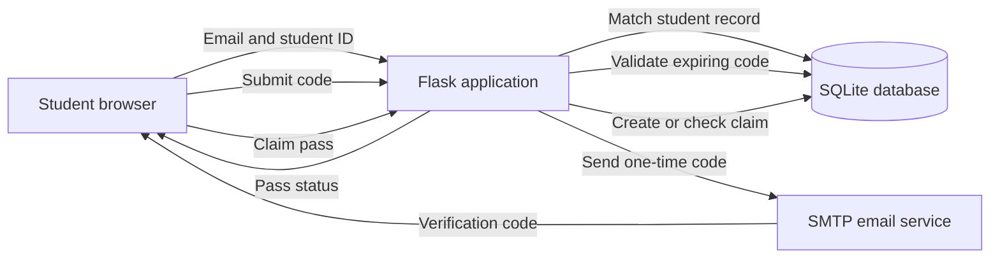

# CampusPass

CampusPass is a University of New Brunswick student bus-pass portal. Students
verify their UNB email address, check their pass status, and claim an available
pass.

## Student experience

1. Enter the UNB email address and seven-digit student ID registered in the
   student records.
2. CampusPass emails a six-digit, one-time verification code to that address.
3. Enter the code within five minutes to verify the student account.
4. See whether a pass has already been claimed. If not, select **Claim my bus
   pass**.

If the email and student ID do not match a record, the portal asks the student
to contact the university.

## Architecture



- **Browser:** The student portal collects the student email, ID, and
  verification code.
- **Flask application (`app.py`):** Validates requests, sends OTP emails,
  verifies codes, manages the student session, and handles pass claims.
- **SQLite (`database.py`, `campuspass.db`):** Stores student records, pass
  claims, OTP challenges, and rate-limit records.
- **SMTP:** Delivers verification codes to the email address on the matched
  student record.

OTP codes expire after five minutes and allow up to five verification attempts.
The application allows up to five failed attempts per IP and 20 OTP requests
per student or IP in a ten-minute window. Pass claims are tied to the verified
student ID.

## Run locally

Install dependencies:

```sh
python3 -m pip install -r requirements.txt
```

Configure email delivery:

1. Create an SMTP account and verify a sender address with your email provider.
2. Copy `.env.example` to `.env`.
3. Fill in the SMTP host, port, username, SMTP password/key, sender address,
   and a long random `CAMPUSPASS_SECRET_KEY`.

The `.env` file is local and ignored by Git. Never commit SMTP credentials.
For Brevo, the SMTP host is `smtp-relay.brevo.com`, typically using port `587`
with STARTTLS. Your student email address must be able to receive mail.

Start CampusPass:

```sh
python3 app.py
```

Open [http://127.0.0.1:5000](http://127.0.0.1:5000).

## Student records

The local database is initialized with one demonstration student. Add
additional students to `campuspass.db` with a unique seven-digit ID and their
registered UNB email:

```sql
INSERT INTO students (student_number, university, student_email)
VALUES ('1234567', 'UNB', 'student.name@unb.ca');
```

## Project scope

This is a local educational simulation. Student verification uses local
demonstration records; it does not connect to UNB identity services or issue a
real transit pass. A production deployment would require institution-managed
identity verification, secure hosting, monitoring, and operational safeguards.
