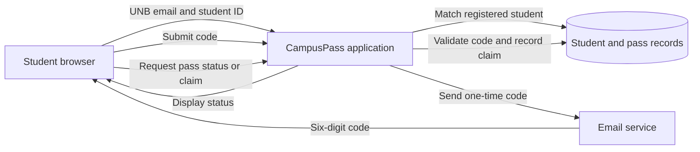

# CampusPass

Working Prototype: https://campuspassunb.vercel.app/

CampusPass is a University of New Brunswick (UNB) student bus-pass portal. It
matches a student's UNB email and student ID to a registered student record,
verifies access through an emailed one-time code, and shows whether a pass is
available to claim or has already been claimed.

## How it works

1. **Enter student details.** The student provides their UNB email address and
   seven-digit student ID. CampusPass checks that both match a registered UNB
   student record.
2. **Verify the email.** CampusPass sends a six-digit one-time code to the
   email address on that record. The code expires after five minutes and can
   be tried up to five times.
3. **Check pass status.** After successful verification, CampusPass displays
   whether the student already has an active bus-pass claim.
4. **Claim an available pass.** If there is no active claim, the student can
   claim the pass. The claim is saved to the student's record, and later visits
   show that it has already been claimed.

Student verification is based on the records maintained for CampusPass; the
portal does not authenticate against a UNB identity service.

## Architecture

- **Student portal:** Collects student details and the emailed code, then
  displays verification and bus-pass status.
- **Flask application (`app.py`):** Checks student records, issues and verifies
  one-time codes, maintains the short-lived verified student session, and
  processes pass claims.
- **PostgreSQL database (`database.py`):** Stores student records, pass claims,
  verification challenges, and request-limit records. Local development uses
  SQLite when `DATABASE_URL` is not set.
- **Email service:** Delivers verification codes to the email address
  registered for the matched student.
